# Import

Click `Import` in [Streamer.bot](https://streamer.bot/) and drag
[BetterStreamAnnouncements.sb](https://github.com/aaskjer/Better-Stream-Announcements/releases/latest) into the window, or paste the
[import string](Import-String.md). Click `Import`, then `Yes` on the popups that follow.

An update works the same way: import the new version over the old one. Your settings live in a file of their own
and stay as they are.

You get fifteen actions in the group `[BsA] - Better Stream Announcements`, seven timers and a queue named `BsA`:

| Action | What it is for |
|---|---|
| `[BsA] - .Settings` | Opens the Settings window. |
| `Broadcaster Online` | Your own go-live announcement, for Twitch, YouTube and Kick. |
| `Broadcaster Offline` | Turns it into the stream-ended message when you stop. |
| `Streamer Friends (Twitch)`, `(YouTube)`, `(Kick)`, `(Owncast)`, `(Rumble)`, `(Picarto)`, `(TikTok)` | One per platform: checks your friends whenever its timer fires and announces them. |
| `[BsA] - Discord Bot Presence` | Your own Discord bot: the connection, its status and the slash commands. Starts with Streamer.bot. |
| `[SF] - Presence Role Assign` | ISLIVE roles from Discord's own "Streaming" activity. |
| `[SF] - Self Role Assign` | `/streamerfriends`: members link their own streaming accounts. |
| `[CC] - Custom Crosspost` | `/crosspost`: members subscribe a channel on their own server to your announcements. |
| `[CC] - Crosspost Dispatch` | Hands every new announcement to those subscriptions. |

Leave everything inside the `NO TOUCHY!` sub-action groups as it is.

## Switch On What You Use

Two things come switched off, so nothing is posted before you have set it up:

- **The timers.** Go to `Timers`. There is one `[BsA\SF]` timer per platform: Twitch, YouTube, Kick, Owncast,
  Rumble, Picarto and TikTok. Right-click each one you use and tick `Enable`.
  **A platform whose timer is off is never checked and never announces anyone.** YouTube fires every 700 seconds to
  stay inside Google's API quota, the others every 400.
- **`Broadcaster Online` and `Broadcaster Offline`.** If BsA should announce your own stream, enable both under
  `Actions` once [Broadcaster → Platforms](#platforms) has somewhere to post. Check them again after an update, since
  the import can bring them back switched off.

---

# Setup

Go to `Actions`, select `[BsA] - .Settings`, right-click the `Test` trigger and choose `Test Trigger`. That opens the
Settings window.

The pages sit in a sidebar, in four groups — **Broadcaster**, **Streamer Friends**, **Discord Bot** and **Help** — with
**Home** on top. `Ctrl+F` searches every page by its labels and setting keys. `Ctrl+S` saves and keeps the window open,
`Save & Exit` closes it; the footer counts what you have changed, and closing with unsaved changes asks first. The ☰ menu
switches between the light and dark theme and resets everything to defaults.

Hover over any field to read what it does. 🔗 next to a field opens the page where you get that key, ❓ explains where to
find a Discord ID. Every setting is stored in `Announcements\Discord\settings.json` next to Streamer.bot.

Most Discord picks can also be made from Discord itself: `/bsa setup` chooses channels, ping roles, ISLIVE roles and bot
admins from Discord's own menus, so you never copy an ID by hand. It needs [your own bot](#create-a-discord-bot).

## Home

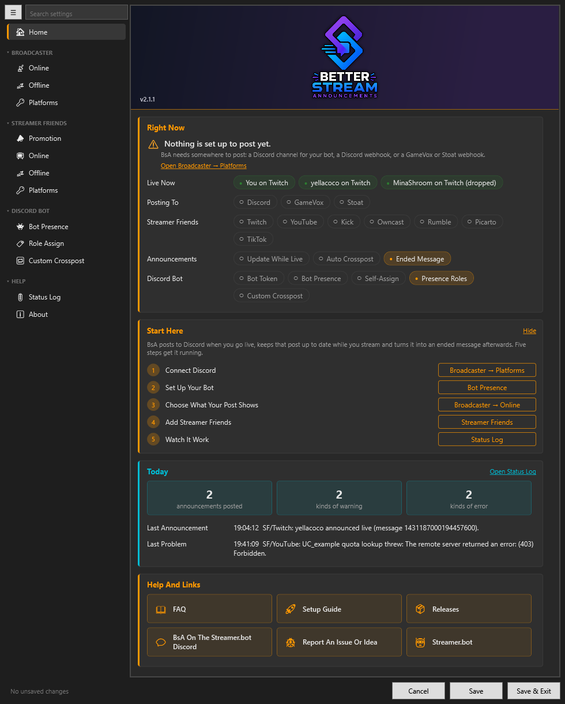

**Right Now** shows who is live, where announcements go and how many Streamer Friends each platform has. **Start Here**
walks through the setup in five steps, each with a button to its page; **Hide** puts it away, and About brings it back.
**Today** counts the announcements, warnings and errors in today's log and names the last problem.

## Where Announcements Go

BsA posts to three places, and each one works on its own:

- **Discord**, either through your own bot (a Channel-ID) or through a webhook. Only the bot gets the **Watch** button and
  a separate channel for stream-ended messages; everything else works with both.
- **GameVox**, through a webhook. It gets the same post minus the buttons and the role mentions.
- **Stoat**, through a webhook. It gets the text and the embed without a preview picture, since Stoat only takes pictures
  uploaded by a bot account.

Set up any one of them, or all three. A target that is not set up, or that refuses a post, never holds the others back.
Your own announcements and the Streamer Friends ones have settings of their own, so they can go to different channels.

## Broadcaster

### Platforms

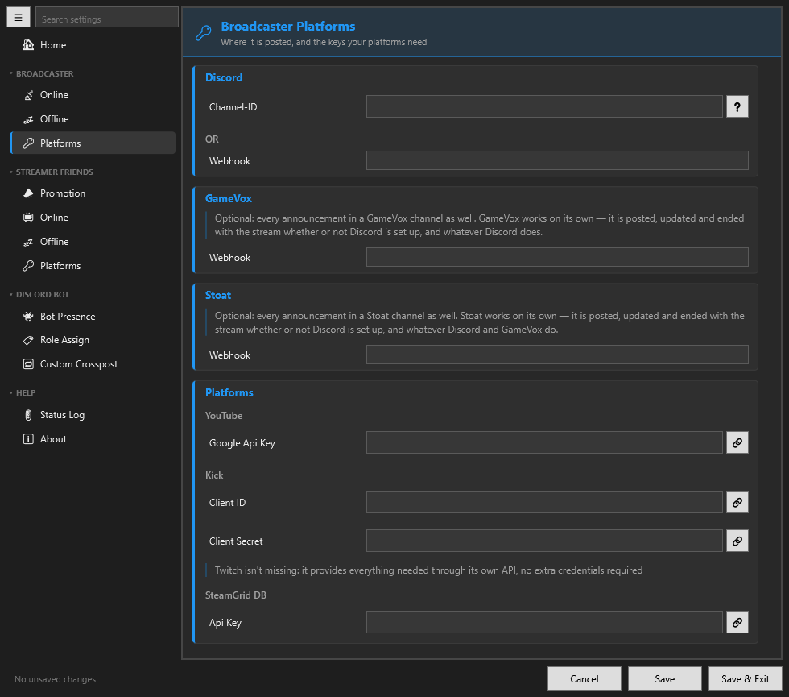

Where your own announcement is posted, and the keys your platforms need:

- **Discord:** a Channel-ID (needs the bot token under [Bot Presence](#bot-presence)) **or** a webhook URL. With both set,
  the channel and the bot win.
- **GameVox** and **Stoat:** a webhook URL each, both optional.
- **YouTube** needs a Google API key, **Kick** a Client ID and Client Secret of its own. Twitch needs nothing here: it
  comes through Streamer.bot's own Twitch connection.
- **SteamGridDB** (optional) adds the game's box art on Kick. Twitch brings its own, and YouTube reports no game.

### Online

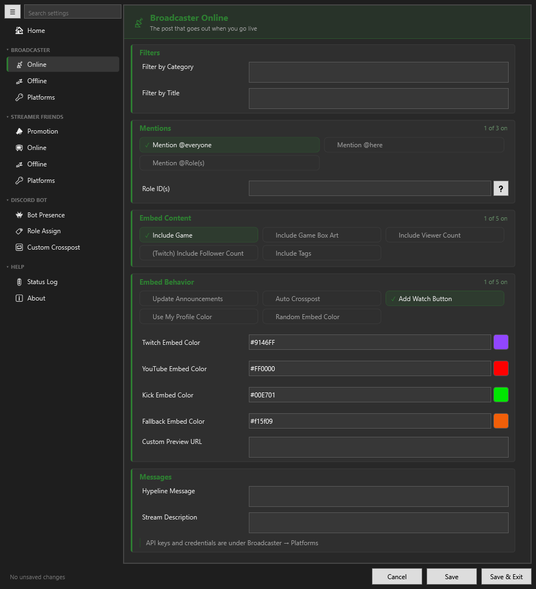

The post that goes out when you go live:

- **Filters:** post only for certain categories, or for titles that contain a keyword. Empty means always.
- **Mentions:** @everyone, @here or roles.
- **Embed Content:** game, box art, viewer and follower counts, tags.
- **Embed Behavior:** keep the post up to date while you stream (**Update Announcements**), publish it to the servers that
  follow your announcement channel (**Auto Crosspost**), the **Watch** button, and where the color comes from — your
  profile color, a random one, or a fixed color per platform. The swatch beside each color opens a picker.
- **Messages:** a line above the embed (**Hypeline Message**) and the embed's own text.

### Offline

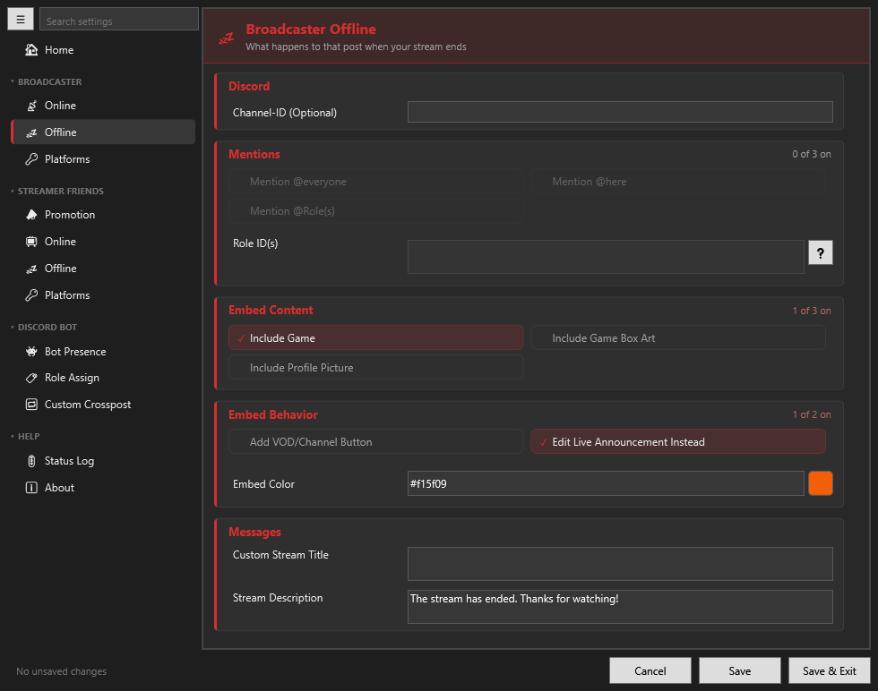

What happens to that post when you stop. With **Edit Live Announcement Instead** on (the default), the live post turns into
the stream-ended one; with it off, a separate message is posted, and a **Channel-ID** here sends that message to another
channel (bot only). Mentions, content, a VOD or channel button, the color and the texts work as on Online.

## Streamer Friends

### Platforms

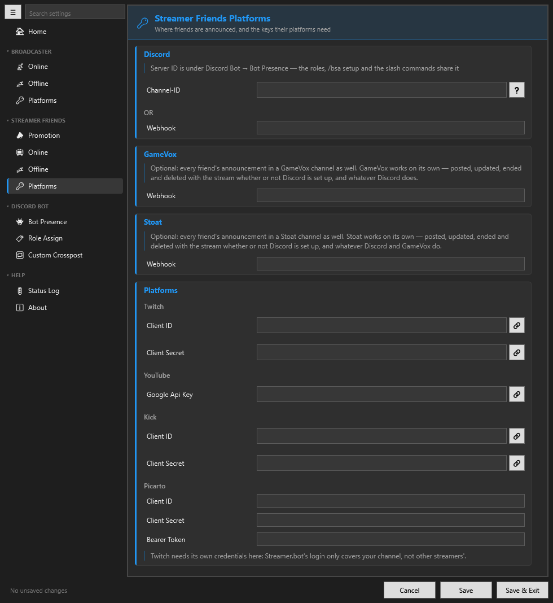

Where your friends are announced — Discord, GameVox and Stoat, as for your own announcement but set up separately — and
the keys their platforms need:

- **Twitch:** a Client ID and Client Secret of your own Twitch app. Streamer.bot's login only covers your own channel, not
  other people's.
- **YouTube:** a Google API key. **Kick:** a Client ID and Client Secret.
- **Picarto:** a Client ID and Client Secret (the token renews itself), or a bearer token.
- **Owncast, Rumble and TikTok** need nothing.

The Discord Server ID lives under [Bot Presence](#bot-presence); the roles, `/bsa setup` and the slash commands share it.

### Promotion

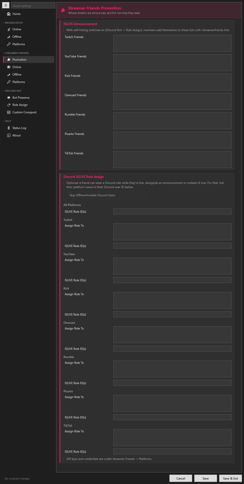

Who gets announced. Each platform has a list of its own, comma-separated:

| Platform | What to enter |
|---|---|
| Twitch, Kick, Picarto | The name from the channel URL: `twitch.tv/aaskjer` → `aaskjer` |
| YouTube | The channel ID or `@handle`; `UC…\|Name` shows a readable name in the Discord menus |
| Owncast | The server address, e.g. `stream.example.org` |
| Rumble | `ApiUrl\|WatchUrl\|DisplayName`; only the livestream API URL is required |
| TikTok | The name from the profile URL: `tiktok.com/@aaskjer` → `aaskjer` |

With self-linking switched on ([Role Assign](#role-assign)), members add themselves with `/streamerfriends link` instead.

**Discord ISLIVE Role Assign** gives a friend a Discord role while they are live. Link their platform name to their
Discord user ID under **Assign Role To** (`aaskjer:123456789012345678`; Owncast and Rumble use `|` instead of `:`, since a
URL already holds one). **All Platforms** is the role for everyone; a platform's own **ISLIVE Role ID(s)** replace it for
that platform.

### Online

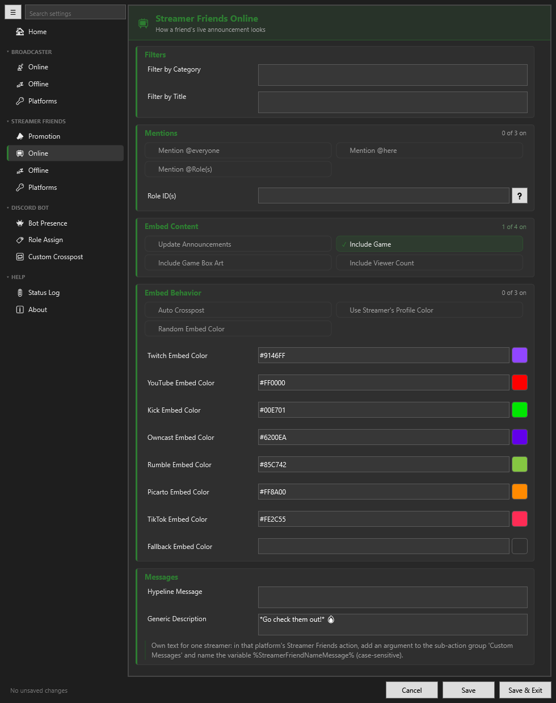

How a friend's live announcement looks: the same filters, mentions and content as your own, **Update Announcements**,
**Use Streamer's Profile Color**, a color per platform, and a **Generic Description** for everyone.

A friend can have a text of their own. In that platform's Streamer Friends action, add a `Set Argument` sub-action to the
group `Custom Messages` and name the variable after the friend as they stand in your list: `%aaskjerMessage%` for the
friend `aaskjer` (case-sensitive). A YouTube `@handle` goes in without the `@`, an Owncast friend by the server's host name
(`stream.example.orgMessage`), a Rumble friend by their display name.

### Offline

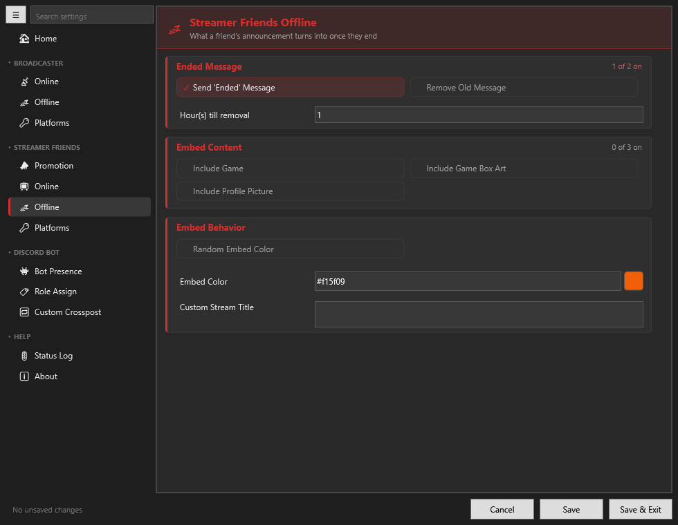

What a friend's announcement turns into once they end: an ended message, and whether the announcement is removed
**Hour(s) till removal** later — on Discord, GameVox and Stoat alike — so the promotion channel stays clean.

## Discord Bot

### Bot Presence

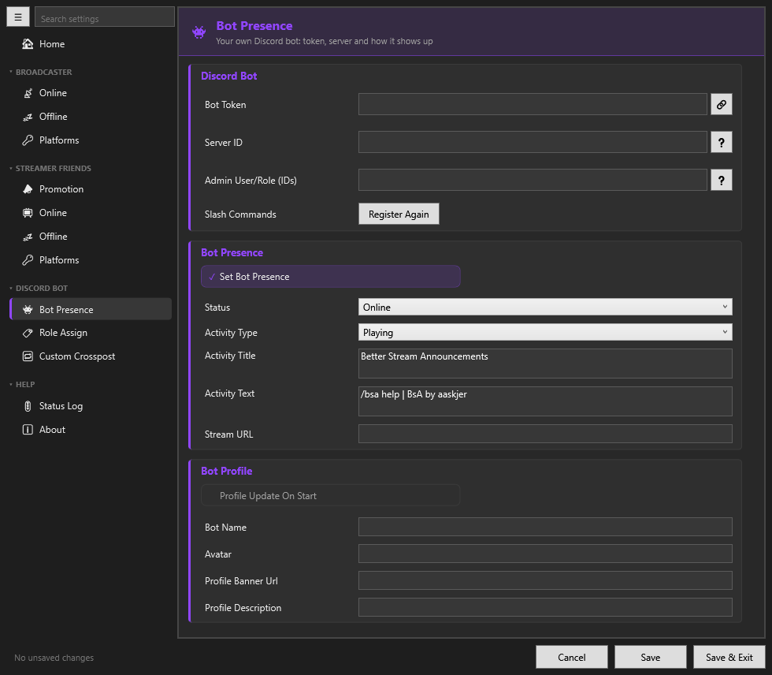

Your own Discord bot: its token, your **Server ID** and the bot admins (users or roles; while empty, everyone with
**Manage Server** counts as one). Below that, the status and activity it shows, and its name, avatar, banner and
description. A webhook alone needs none of this, but the bot is what runs the slash commands, the roles and the Watch
button.

**Slash Commands → Register Again** pushes `/bsa`, `/streamerfriends` and `/crosspost` to Discord once more, for example
after inviting the bot again.

### Role Assign

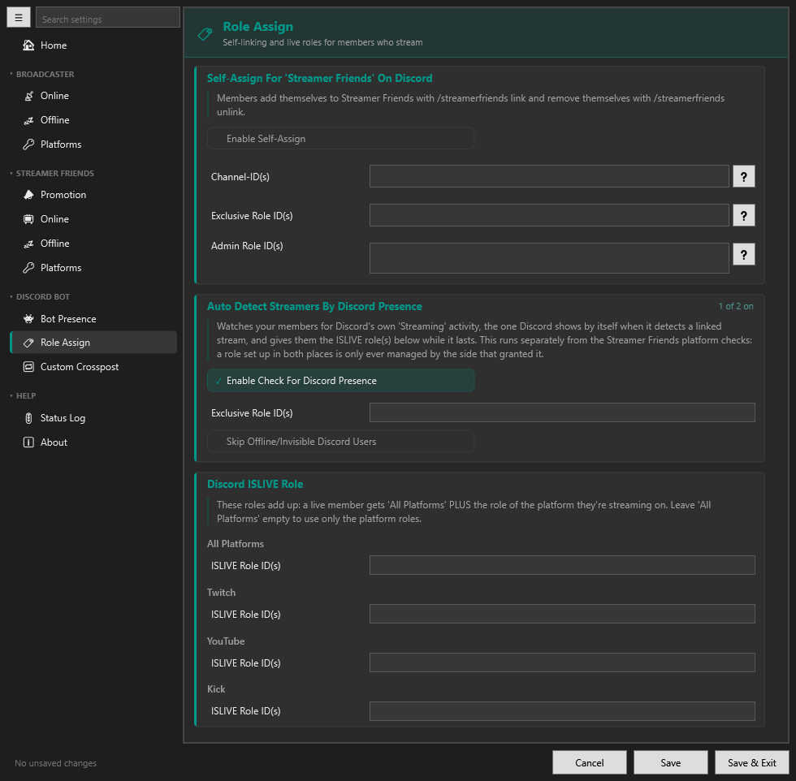

- **Self-Assign** lets members add themselves to Streamer Friends with `/streamerfriends link`. Limit it to roles with
  **Exclusive Role ID(s)** (e.g. `Members`) if not literally everybody should be able to.
- **Auto Detect Streamers By Discord Presence** gives the ISLIVE roles below to members whose Discord shows them as
  streaming. It runs apart from the Streamer Friends checks; a role is only ever taken back by the side that gave it.

### Custom Crosspost

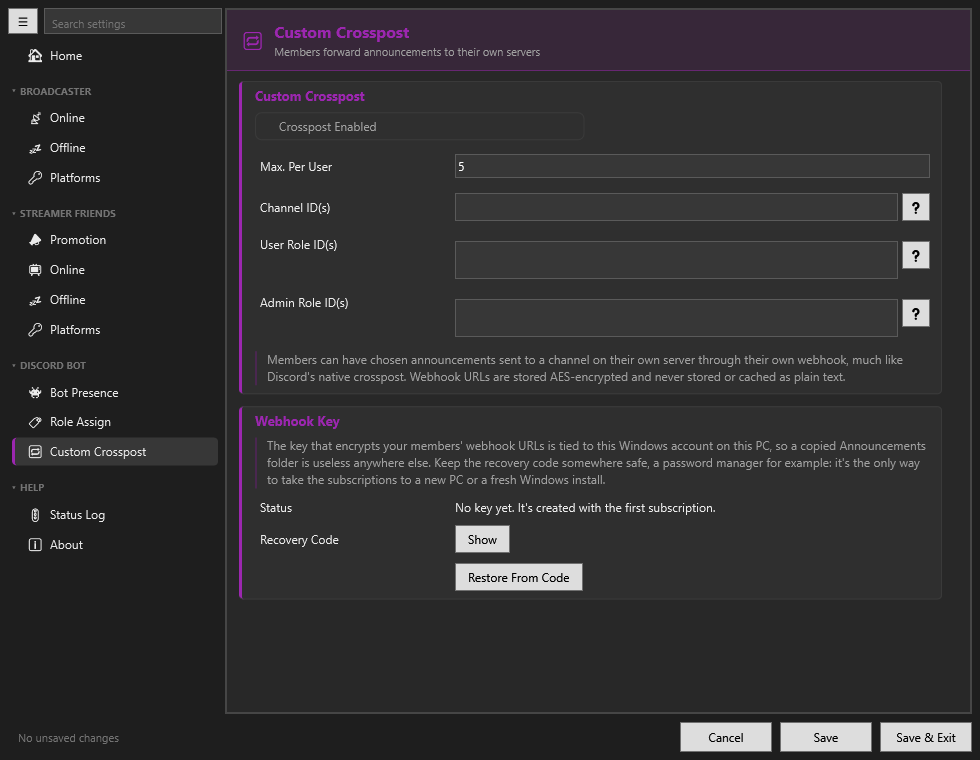

Members send chosen announcements to a channel on their own server through their own webhook, set up with
`/crosspost setup`. Their webhook URLs are stored encrypted with a key tied to this Windows account: use
**Recovery Code → Show** and keep the code somewhere safe, it is the only way to take the subscriptions to another PC.

## Help

### Status Log

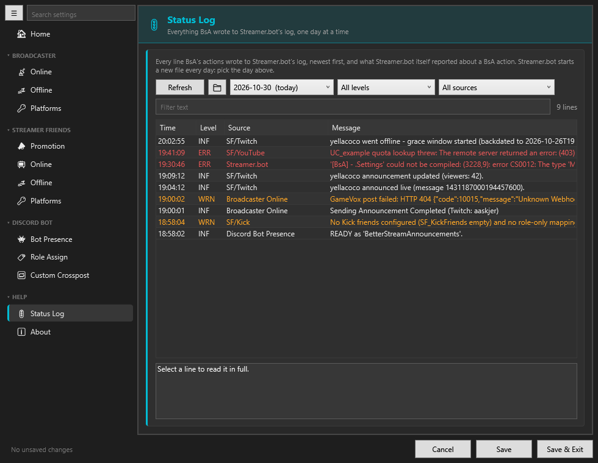

Everything BsA wrote to Streamer.bot's log, one day at a time, plus what Streamer.bot itself reported about a BsA action
— an error naming it, or a script that would not compile. Filter by day, action, level and text; select a line to read it
in full. Start here when something is not posted.

---

# Create A Discord Bot

Needed for the slash commands, `/bsa setup`, the roles and the Watch button. Webhooks work without one.

* Go to [discord.com/developers/applications](https://discord.com/developers/applications) and click `New Application`
* Under `Bot`, go to `Privileged Gateway Intents`, enable `Presence Intent` and `Server Members Intent`, then save
  * `Message Content Intent` is not needed and can stay off: the bot runs on slash commands
* Under `Bot`, click `Reset Token` and paste the token into **Bot Token** under Discord Bot → Bot Presence
* Go to `OAuth2` → `OAuth2 URL Generator` and select the scopes `bot` **and** `applications.commands`
  * Without `applications.commands` the slash commands never show up in your server
* Tick `Administrator` under the `Bot Permissions` that appear
* Open the generated URL, pick your server and click `Authorize`

The bot registers `/bsa`, `/streamerfriends` and `/crosspost` by itself once it connects. If they do not appear, use
**Slash Commands → Register Again** under Discord Bot → Bot Presence. Then run `/bsa setup` in your server.

All commands are listed in the [FAQ](FAQ.md#-discord-bot--commands).
